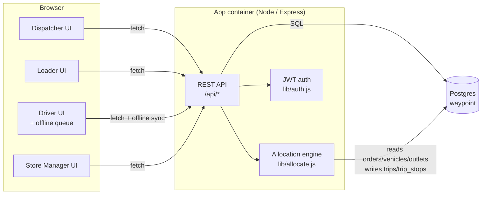

# Architecture — Waypoint Ops (TechPulse)

## Components

## Why this shape

- **One container serves both the API and the built React app.** This keeps `docker compose up` to two real services (the app and Postgres, plus a one-off seed step), which matches the brief's requirement that the stack starts with a single command.
- **The allocation engine is a plain module, not a separate service.** It is called synchronously from `POST /api/dispatcher/allocate`, reads the confirmed orders and available vehicles for one date/depot, and writes the resulting trips and trip_stops in a single transaction. Keeping it in-process means the dispatcher's "run allocation" action and its result are atomic and easy to reason about for a judge reading the code.
- **The driver's offline queue lives in the browser (`localStorage`), not in the backend**, because the entire point of the degradation scenario is that the device has no connection to the backend. Queued events are only sent to `POST /api/driver/sync` once the connection is back, and the backend — not the client — decides whether a queued event conflicts with something that happened on the server while the driver was offline (e.g. the dispatcher deferring the same order).
- **Every deferral, flag, delivery, and receipt is also written to an `events` table** (an append-only audit log), independent of the current-state tables. This is what lets the dispatcher explain *why* an order was deferred days later, and is a direct answer to the brief's "deferrals lack a clear record" problem.

## Request flow for the two degradation scenarios

**Capacity Shortfall Resolution (dispatcher):**
`POST /dispatcher/allocate` → allocation engine marks orders `deferred` with a reason →
`GET /dispatcher/shortfall` ranks them (previously-deferred orders first) →
dispatcher calls `POST /dispatcher/orders/:id/decision` to force-fit or confirm the deferral, which is logged to `events`.

**Offline Delivery Queue (driver):**
Driver actions while offline are kept in `localStorage` →
on reconnect, `POST /driver/sync` replays them →
the backend checks each event's order against its current `dispatch_status`; if the dispatcher deferred it in the meantime, the event is returned as a conflict instead of being applied →
`POST /driver/sync/resolve` lets a human pick which record stands.

## Known simplifications (documented per the brief's request for significant departures)

- Outlet delivery-window and mall-window timing is enforced at the **trip-budget level** (the Fresh pre-dawn budget and the Style/Tech daytime budget from the booklet's formula), not as a minute-by-minute route simulation. A full turn-by-turn ETA engine was out of scope for the Hackathon window.
- The Designathon mockup illustratively placed OUT001's chilled order on a reefer **truck**; the working allocation engine correctly requires a reefer **van** for any `van_only` + chilled outlet, and does so automatically. This is a deliberate improvement caught by building the real constraint checker — see `lib/allocate.js`.
- "Simulate offline" is a manual toggle on the Driver screen (in addition to real `navigator.onLine` checks) so a judge can reliably trigger the offline/degradation path without needing to physically disconnect from a network during the walkthrough.
