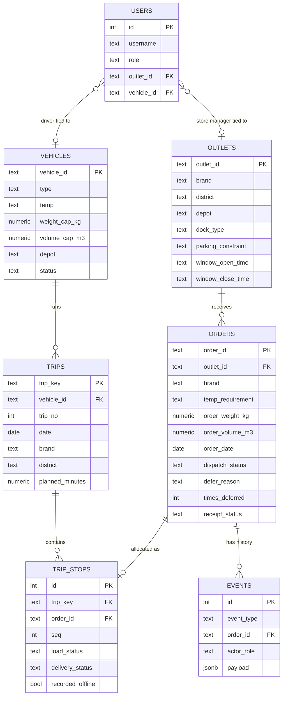

# Data model — Waypoint Ops

Full DDL is in `backend/src/schema.sql`. Reference tables are loaded directly from
the competition's `outlets.csv`, `vehicles.csv`, `calendar.csv`, `district_travel.csv`
and `service_allowance.csv`. Everything else is live operational data this system owns.

## Why a few fields are shaped the way they are

- **`orders.times_deferred`** is incremented every time an order is deferred rather than served, and is the field the Capacity Shortfall screen sorts on. An order with `times_deferred > 0` is shown as "do not defer again" and is force-fit onto capacity before any first-time order is considered — this is how the system answers the brief's "deferrals… leave the same outlet unserved on consecutive runs" problem with an actual rule instead of a dispatcher's memory.
- **`trip_stops.seq`** is delivery order (ascending). The loader's checklist queries the same rows ordered **descending**, because goods must be loaded in reverse of the order they're delivered in — this is enforced by the query, not duplicated as separate data.
- **`trip_stops.recorded_offline`** and the **`events`** table together are the audit trail for the offline-conflict degradation scenario: a reconciled record still shows it was captured offline, and the `events` row shows which human decision resolved the conflict and when.
- **`events` is append-only and separate from current-state columns** on purpose. `orders.dispatch_status` always reflects the current decision; `events` is the full history of how it got there. A dispatcher asking "why was OUT058 deferred on Tuesday" is answered by `events`, not by overwriting a single status field.
